# EnduroNotes

**Цифровой гараж для эндуро и кроссовых мотоциклов**

EnduroNotes помогает проводить сервис мотоцикла по интервалам ТО, вести расходы и считать
стоимость моточаса, держать под рукой руководства, рассчитать премикс и записывать GPS-треки.

## Скачать

**[⬇ Последняя версия](https://github.com/Ajleksey13/EnduroNotes-releases/releases/latest)** —
откройте ссылку на телефоне и скачайте файл `EnduroNotes_vX.Y.Z.apk`.

Android 5.1 и новее.

## Установка и обновление

1. Скачайте APK из раздела **Releases**.
2. Откройте файл. Если Android спросит — разрешите установку из этого источника
   (браузера или файлового менеджера).
3. Play Защита может предупредить о незнакомом приложении — это нормально для приложений
   не из магазина: «Подробнее» → «Всё равно установить».

Новая версия ставится поверх старой, данные сохраняются. Перед обновлением рекомендуется
сделать копию: боковое меню → «Сохранить копию».

## Возможности

### Мотоциклы
Карточка с фото для каждого мотоцикла. Пробег в моточасах (м/ч) или километрах, кнопки + / −
для обновления. Под названием — ближайшее ТО: зелёное, оранжевое, когда пора, или красное,
если просрочено; нажмите, чтобы открыть сервис.

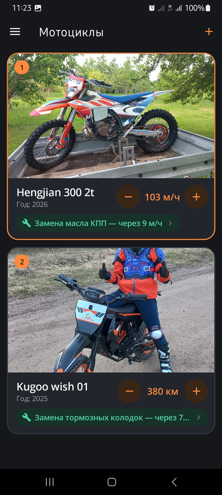 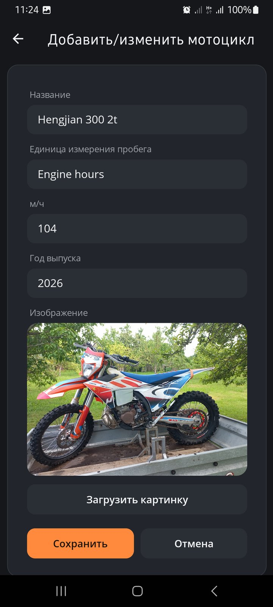

### Сервис и периодичность
Пункты обслуживания по категориям, интервалы в моточасах или км и напоминания о приближающемся ТО.
Кнопка ✓ «ТО выполнено» обнуляет счётчик, записывает событие в историю с фото и может сразу
добавить расход.

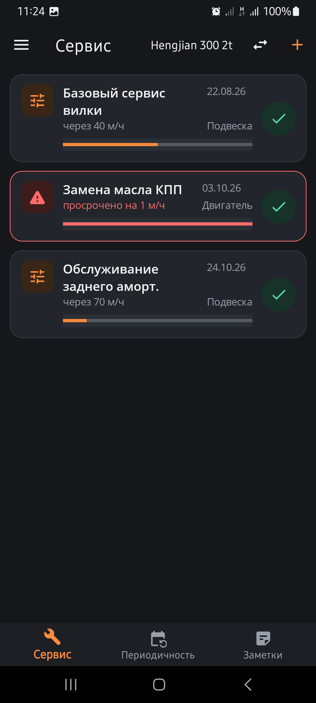 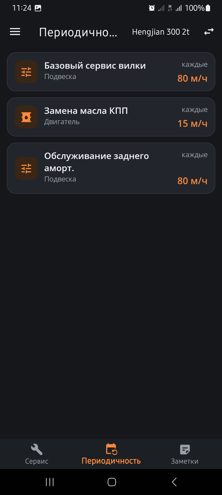

### Фото к записям
В окне добавления сервиса, запчастей, экипировки и прочих расходов можно прикрепить фото:
из галереи или сразу с камеры. К сервису фото сохраняются вместе с событием в истории.

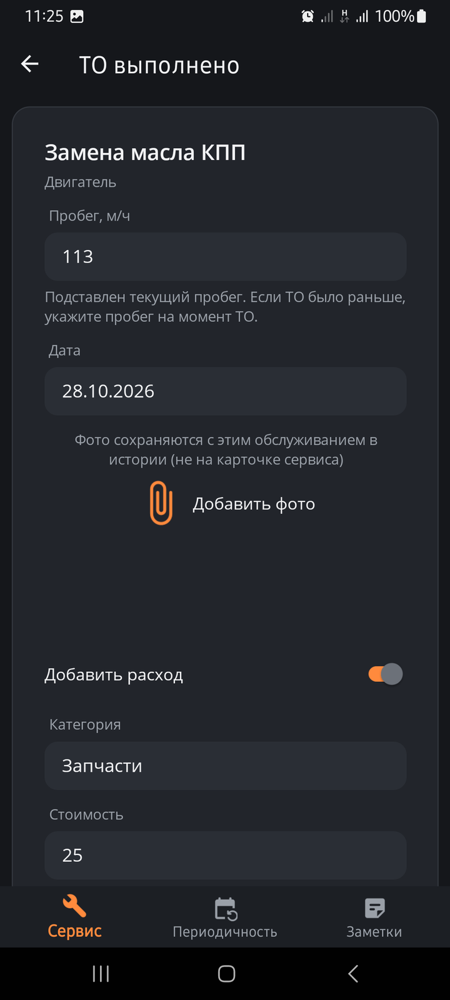 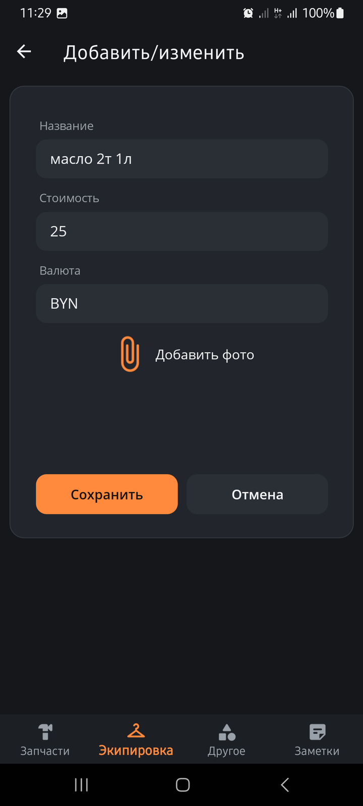

### Заметки
Быстрые заметки по каждому мотоциклу — списки покупок, идеи и напоминания, привязанные
к выбранному байку.

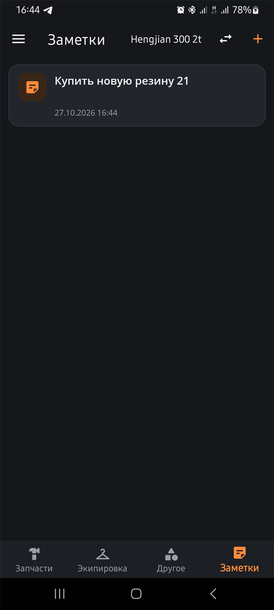

### Расходы
Запчасти, экипировка и прочие траты — с фото чека из галереи или с камеры. Итог в основной
валюте по вашим курсам и стоимость моточаса или километра: запчасти и прочее, делённые на пробег.

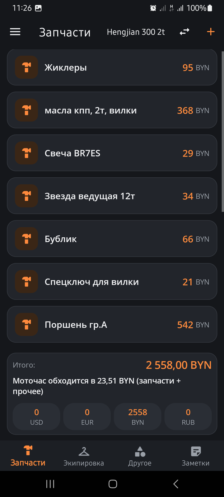 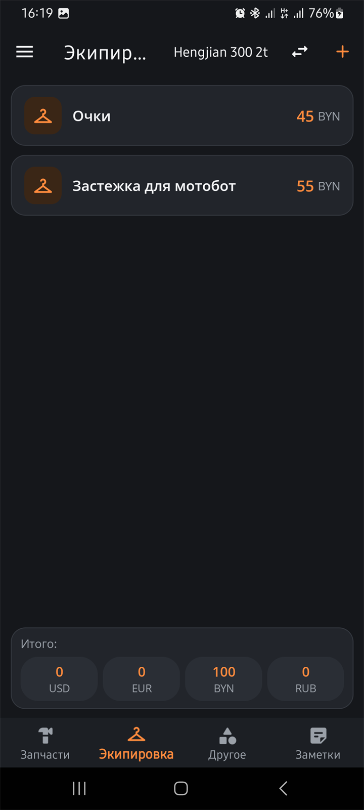

### Калькулятор премикса
Расчёт масла для двухтактного двигателя от объёма бензина или обратно от масла.
С учётом плотности — и в миллилитрах, и в граммах.

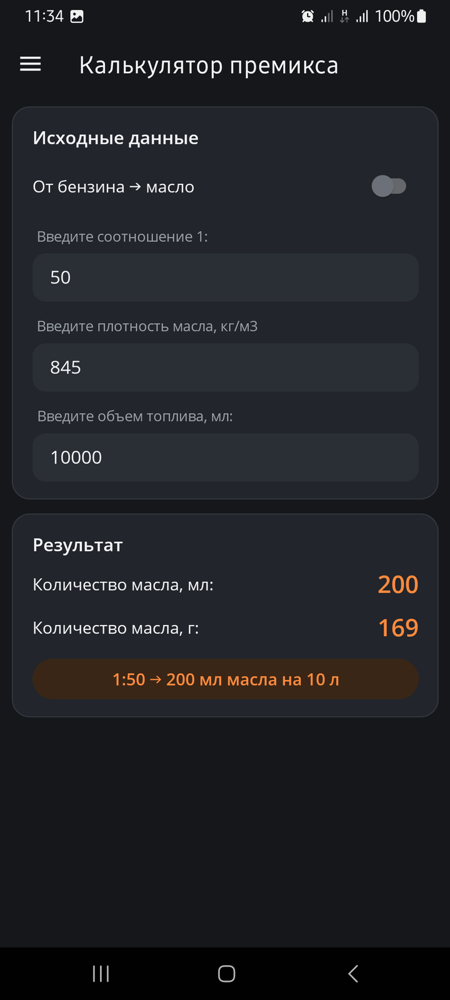 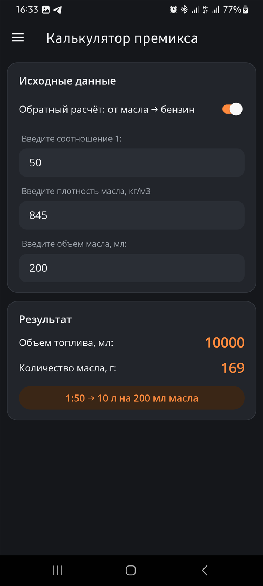

### Руководства
Храните руководства по эксплуатации и ремонту, а также каталоги запчастей в PDF
для выбранного мотоцикла.

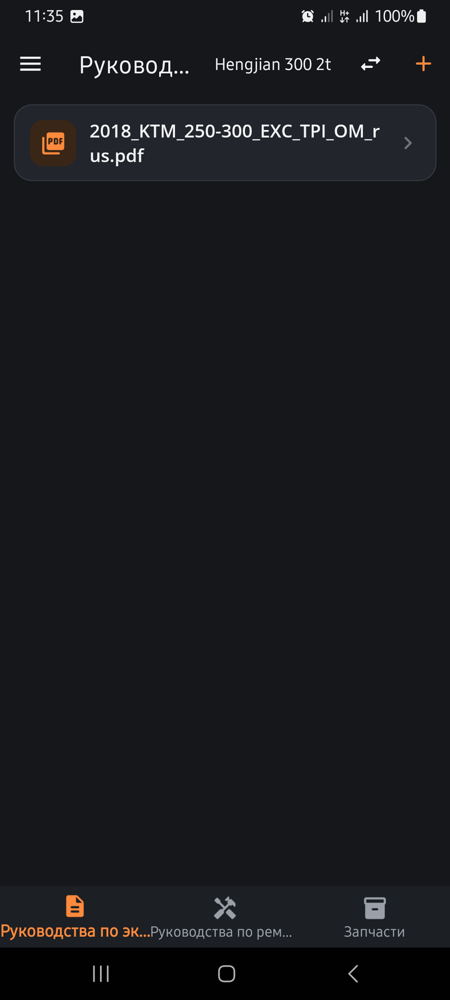

### История
Вся история обслуживания и покупок по мотоциклам — даты, категории, пробег и суммы.
Сервисная книжка в PDF или CSV с фото работ пригодится при продаже мотоцикла.

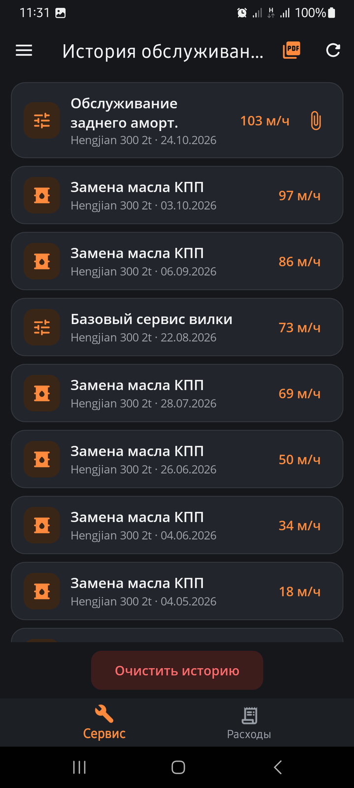 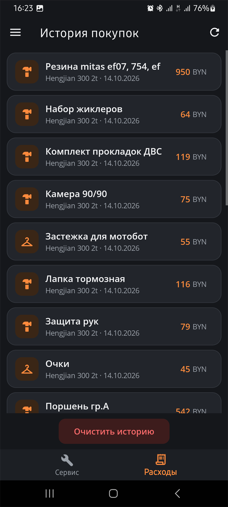

### GPS-треки
Запись поездок на карте с дистанцией, временем и скоростью. Графики высоты и скорости,
максимальная скорость и набор высоты. Экспорт в GPX, KML и GeoJSON, импорт также из KMZ.

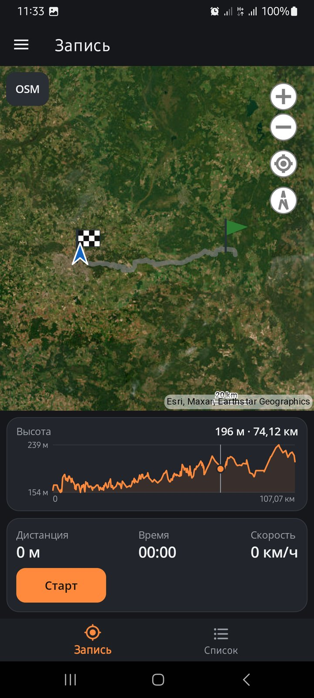 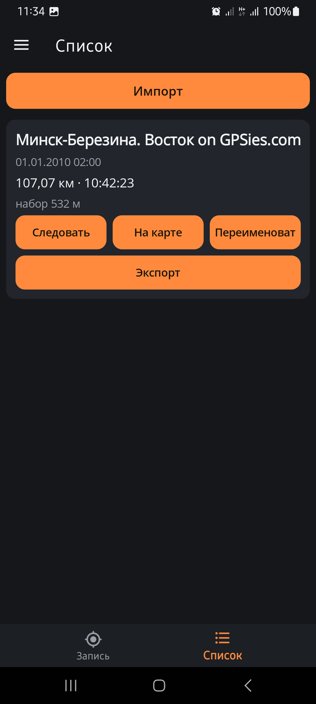

### Настройки и резервные копии
Язык (русский или английский) и тема (тёмная или светлая) — в боковом меню.
Шестерёнка справа от «EnduroNotes» открывает настройки: пороги напоминаний о ТО,
шаг кнопок пробега, валюта и курсы, оформление. Там же, в боковом меню, — сохранение копии
данных и восстановление при смене телефона, а «Руководство пользователя» объясняет все разделы.

---

*Для тех, кто следит за своим мотоциклом.*
